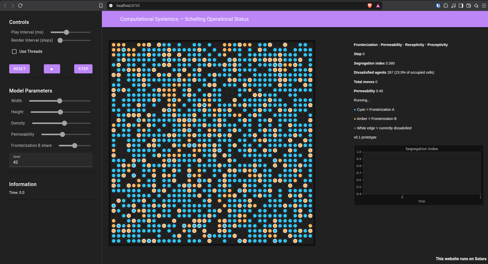
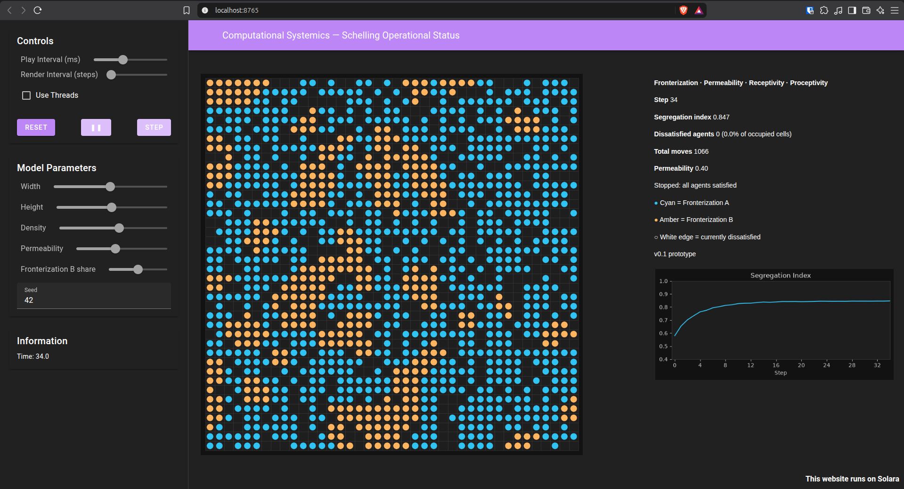

# Schelling Operational Status (v0.1)

A Mesa implementation of Schelling segregation whose tolerance and movement rules are Operational Status terms from Conciliatorics. This is the single-criterion binary case: every agent carries a list of one `StatusEntry` (`criterion = "type"`, fronterization `0` or `1`).

The coding reference is `docs/schelling-operational-status-spec.md`.



## Quick start

From the repository root, one command creates `.venv` if needed, installs dependencies when they are missing or outdated, and starts the dashboard:

```bash
chmod +x setup.sh   # only needed once
./setup.sh
```

Open the local URL the script prints. Stop the dashboard with Ctrl+C. `./setup.sh` runs in its own shell, so a later terminal activates the environment with `source .venv/bin/activate`.

The same steps by hand:

```bash
python3 -m venv .venv
source .venv/bin/activate
pip install -r requirements.txt
solara run app.py
```

`requirements.txt` installs Mesa 3.5.1 with its visualization extra (Solara and Matplotlib) and NetworkX, which Mesa imports at startup. Mesa 3.5 needs Python 3.12. The page is the live grid, the segregation chart, and the parameter controls.

For a printed step log in the terminal, use `python run.py`. See [Run](#run) for the flags and the columns.

## Repository layout

- `app.py` — interactive dashboard. Launch with `solara run app.py`.
- `run.py` — one simulation, printed step by step.
- `schelling_status/` — the model.
  - `status.py` — `StatusEntry` (fronterization and permeability).
  - `agent.py` — `SchellingAgent` (Receptivity and Proceptivity).
  - `model.py` — `SchellingModel` (grid, step, segregation index).
- `requirements.txt` — pinned Mesa visualization install and NetworkX.
- `setup.sh` — create `.venv`, install if needed, and start the dashboard.
- `docs/` — design documents.
  - `schelling-operational-status-spec.md` — v0.1 coding reference.
  - `visualization-spec.md` — dashboard contract.
  - `computational-systemics-summary.md` — why this model exists, and the Operational Status mapping.
  - `conciliatorics.md` — source treatise for the operators.

## Operational Status mapping

| Term | In the code |
| --- | --- |
| Fronterization | `StatusEntry.fronterization`. The current attribute value. |
| Permeability | `StatusEntry.permeability`. Fraction of similar neighbors required, in `[0, 1]`. |
| Receptivity | `SchellingAgent.receptivity()`. Fires when local similarity is strictly below permeability for any status entry. |
| Proceptivity | `SchellingAgent.proceptivity()`. Moves the agent to a random empty cell when Receptivity fires. Stays if the grid has no empty cell. |

`SchellingAgent.statuses` is always a list. The step loop calls `activate()` on each agent and does not mention how many entries that list holds. Receptivity walks the list and fires if any entry is breached.

Similarity on a criterion is an exact match of fronterization. Empty cells are left out of the ratio. An agent with no occupied neighbors has an undefined ratio and is treated as satisfied.

The segregation index is the mean of those defined ratios. Agents with no occupied neighbors are omitted from the mean.

## Grid and schedule

- Non-toroidal Moore neighborhood (8 cells, fewer on the border).
- One agent per cell. Vacancy rate defaults to 0.15.
- Two equal groups. Values are `0` and `1` and do not change (`mutable=False`).
- Each step activates agents in random order. A move is visible to agents activated later in the same step.
- The run stops when no agent is dissatisfied, or at the step cap.

## Dashboard

```bash
source .venv/bin/activate
solara run app.py
```

The page is a live grid plus the segregation chart. Cyan is Fronterization A, amber is Fronterization B, and a white edge means Receptivity is firing. Permeability, density, grid size, the share of Fronterization B, and the seed are sliders. Play, pause, step, and reset are Mesa's controls in the sidebar. Dashboard defaults are a 40×40 grid, density 0.75, permeability 0.40, Fronterization B share 0.30, and seed 42.

The dashboard runs on your machine. The Computational Systemics page on the website links to this repository. Casual viewers see the model in a stream or a short recording.

## Run

From the repository root, with the project virtual environment:

```bash
source .venv/bin/activate
python run.py
python run.py --permeability 0.3 --seed 1
```

`run.py` prints one row per step. Step 0 is the initial grid (`moves` is 0). Later rows are the grid after that sweep. `dissatisfied` and `segregation_index` describe that grid. `moves` is how many agents relocated during the sweep.

The same series is on the model after the run:

```python
model.datacollector.get_model_vars_dataframe()
model.fronterization_grid()  # rows are y, columns are x, None is empty
```

## Defaults

| Parameter | Default |
| --- | --- |
| grid width, height | 50, 50 |
| vacancy rate | 0.15 |
| types | 2 |
| permeability | 0.4 |
| steps | 150 |
| seed | 1 in `run.py` (omit `seed` when constructing `SchellingModel` to draw one) |

## v0.1 scope

This version is binary Schelling, with the four Operational Status names kept visible in the code.

- One criterion. Fronterization is `0` or `1`, stored on a `StatusEntry`. Each agent carries a list of one entry. The step loop does not depend on that length, so a second entry can be added without rewriting it.
- One permeability for the whole run. It is chosen before the run and stays put while agents move.
- Clustering of the classic Schelling kind when permeability is around 0.3–0.5.
- A browser dashboard with the live grid, the step stats, and the segregation chart.

Anything beyond that run is listed under [Deferred](#deferred).

## Deferred

Dynamic fronterization updates, relevance weights, Hypo/Hyper and Sub/Supra gradations, interaction beyond the independent per-entry check, YAML config, and parameter sweeps.

